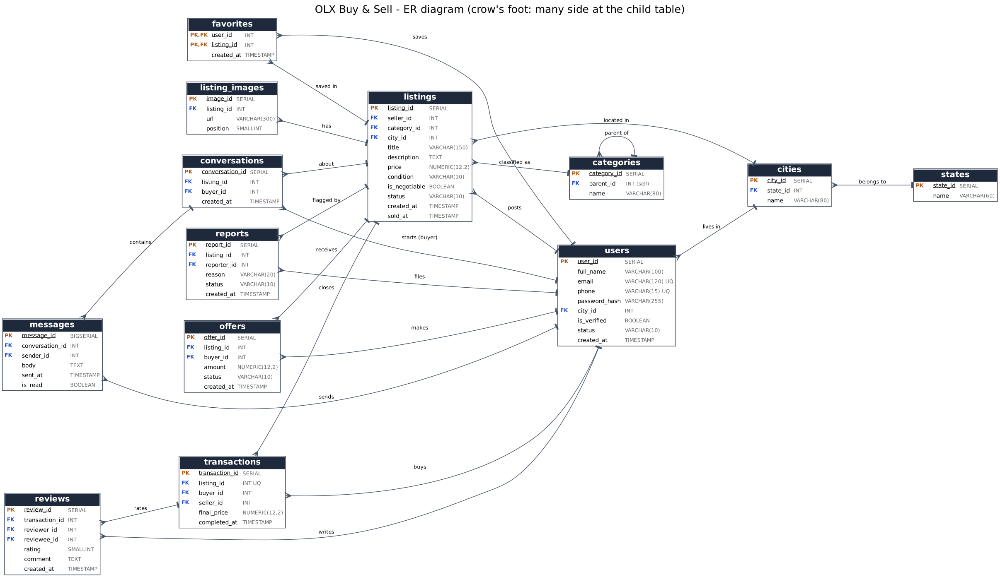
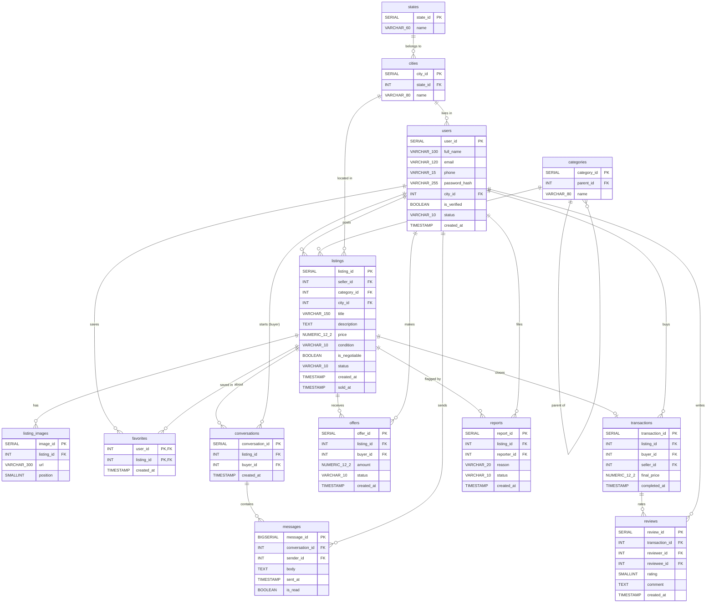

# CP2 - ER diagram: OLX Buy & Sell

Image versions: [02_er_diagram.png](02_er_diagram.png), [02_er_diagram.svg](02_er_diagram.svg) (source: `02_er_diagram.dot`).

## Mermaid version (renders on GitHub)

## Relationships and cardinalities

| Parent (1) | Child (N) | Meaning |
|---|---|---|
| states | cities | belongs to |
| cities | users | lives in |
| categories | categories | parent of |
| users | listings | posts |
| categories | listings | classified as |
| cities | listings | located in |
| listings | listing_images | has |
| users | favorites | saves |
| listings | favorites | saved in |
| listings | conversations | about |
| users | conversations | starts (buyer) |
| conversations | messages | contains |
| users | messages | sends |
| listings | offers | receives |
| users | offers | makes |
| listings | transactions | closes |
| users | transactions | buys |
| transactions | reviews | rates |
| users | reviews | writes |
| listings | reports | flagged by |
| users | reports | files |

- `favorites` is the associative table for the many-to-many relationship between users and listings (composite PK).
- `transactions.listing_id` is UNIQUE: a listing is sold at most once (1:1 with a sale).
- `reviews` has UNIQUE (transaction_id, reviewer_id): each party reviews a sale once.
- `conversations` has UNIQUE (listing_id, buyer_id): one chat thread per buyer per listing.
- `categories.parent_id` is a recursive (self) relationship that forms the category tree.
